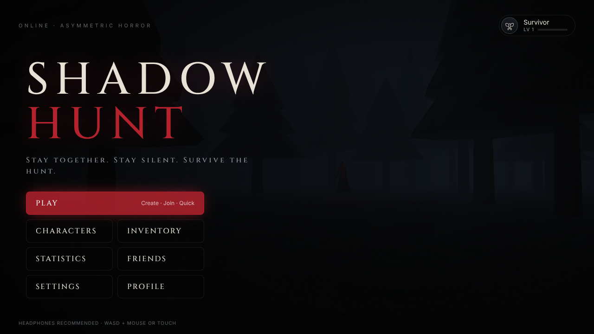
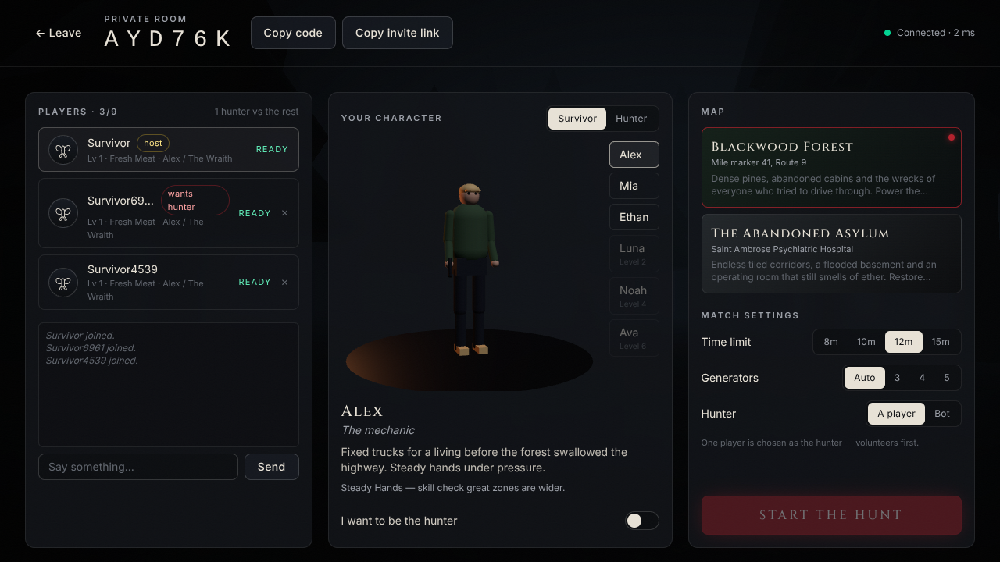
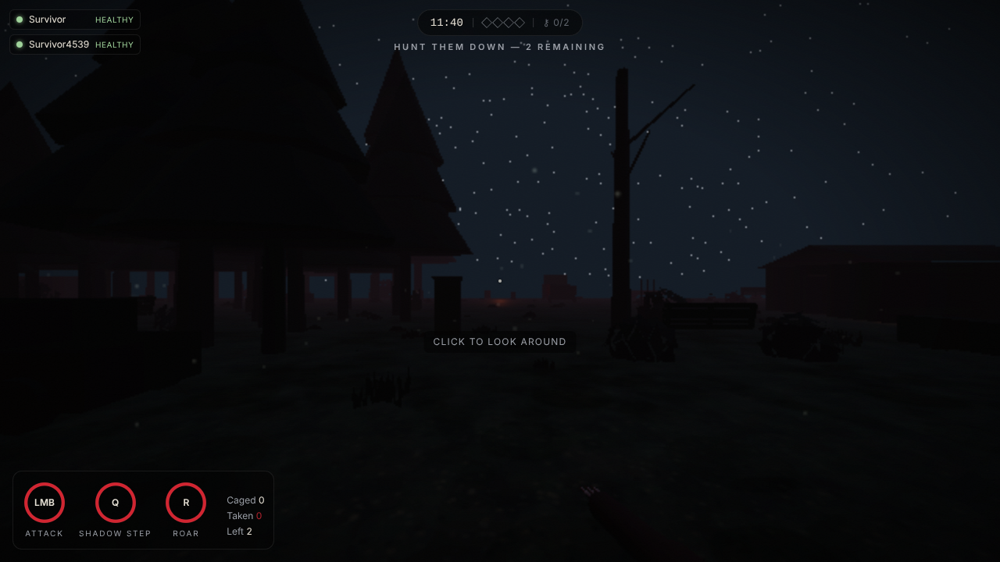
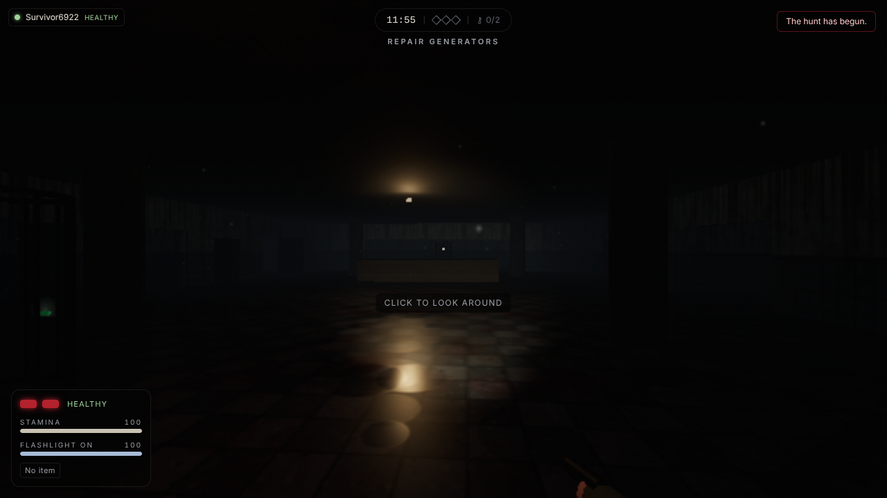
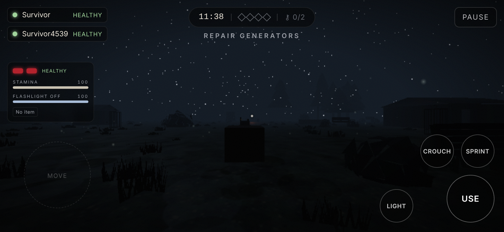

# SHADOW HUNT

*Stay together. Stay silent. Survive the hunt.*

A browser-based, real-time multiplayer asymmetric horror game. One Hunter versus up to eight Survivors in first-person 3D. Survivors repair generators, find access keys, open an exit gate and escape. The Hunter tracks them by sound and blood, downs them and locks them in cages. It runs on desktop and on phones (landscape, touch controls). Friends join with a six-letter room code or an invite link.

The server is authoritative. Clients only send inputs and intents. Movement, hits, captures, objectives, timers, results and XP are all simulated and validated on the Colyseus server.

| Menu | Lobby | Hunter view (forest) |
|---|---|---|
|  |  |  |
| **Asylum, flashlight** | **Phone (landscape)** | |
|  |  | |

_Screenshots are from the automated e2e run (headless Chrome, software-rendered, low preset)._

---

## Quick start (local)

Requirements: Node 20.19+ (22 recommended) and pnpm 10.

```bash
pnpm install
pnpm dev            # game server on :2567 + web client on :5173
```

Open http://localhost:5173 in two browser windows. Then:

1. Play → Create Room in the first window.
2. In the second window, use **Copy invite link**, or Play → Join Room with the code.
3. Ready up and start.

To play alone, set **Hunter → Bot** in the lobby.

Phones on the same Wi-Fi can join at `http://<your-LAN-IP>:5173`. The client automatically targets port 2567 on the same host.

No database is needed for local play. Profiles, XP and match history are saved in `apps/server/data/dev-db.json`. Configure Supabase (see `docs/DEPLOYMENT.md`) for production accounts and Google or email sign-in.

## Controls

| Action | Desktop | Mobile |
|---|---|---|
| Move | W A S D | Left-side floating joystick (push to the rim to sprint) |
| Look | Mouse (click to lock pointer) | Swipe on the right half |
| Sprint / Crouch | Shift / C (or Ctrl) | Sprint / Crouch toggles |
| Interact (hold for repairs, rescues, gates) | E | Use (hold) |
| Skill check | Space, left click or E | Tap anywhere on the right half |
| Flashlight / Use item | F / G | Light / Item |
| Hunter attack / power / roar | Left click / Q / R | Attack / Power / Roar |
| Player status / Pause | Tab / Esc | Pause |

All keys can be rebound in Settings → Controls.

## What's in the game

- **Two maps.**
  - **Blackwood Forest:** about 470 procedurally placed pines, three cabins, a tool shed, wrecked vehicles, and a concrete hatch down to an underground bunker.
  - **The Abandoned Asylum:** patient rooms, an operating room, Ward A, records, showers, pharmacy, a security room, isolation cells, a cafeteria and a kitchen. It has locked doors that open when the power is restored, two exits, and a basement reached by two stairwells.
- **Objective chain.** Repair generators (with server-issued skill checks; a failed check makes noise). Restore power. Find access keys (they drop when the carrier is downed). Insert the keys at an exit panel. Open the gate. Run through the exit zone. The number of generators required scales with the survivor count or a host setting.
- **Capture state machine.** The states are healthy, injured, downed, captured, rescued, escaped and eliminated, and every transition is validated server-side.
  - Two hits down a survivor.
  - The Hunter cages downed survivors. Teammates break the cage, and cage timers shorten on a second capture.
  - Downed survivors bleed out. Teammates can revive or heal them, or they can use a med kit.
- **Survivor tools.**
  - Stamina-limited sprinting, which makes noise and leaves scratch marks.
  - Quiet crouching.
  - Lockers: you start breathing audibly after about 14 seconds and are forced out after 32. A Hunter searching your locker drags you out.
  - Pallets that stun the Hunter, and doors.
  - Flashlight with a battery, plus battery pickups.
  - Firecrackers: a distraction that also blinds a Hunter standing close to them.
  - Med kits.
- **Hunters.**

  | Hunter | Ability | Effect |
  |---|---|---|
  | The Wraith | Shadow Step | Blink to a shadow point you are looking at |
  | The Butcher | Brutal Charge | Rush forward; hitting a wall stuns you |
  | The Hollow | Echo Sense | Reveals survivors who are moving nearby, through walls |

  All Hunters also have a roar that makes survivors flinch audibly, break pallets and kick generators. They track survivors by jittered noise pings and blood or scratch trails, never by exact positions.
- **Characters.** Six survivors with small perks and three hunters, all built as procedurally animated articulated rigs. They have walk, run, crouch, injured limp, downed crawl, caged, work, attack, hit and stun poses. Two skins each.
- **Progression.** XP and levels up to 50, character and skin unlocks by level, titles, eight achievements, lifetime statistics and match history. Everything is earned through play, with no purchases.
- **Online.** Private rooms with hard-to-guess codes, invite links, Quick Match into public lobbies, ready-up, and host controls (map, time limit, generators, player or bot hunter, kick). Lobby chat, a friends list with presence and "join their lobby", reconnection after a dropped connection or a page reload, spectating after you escape or die, and a bot that takes over if the Hunter player leaves.
- **Atmosphere.**
  - Exponential fog, moonlight with shadows, flickering pooled practical lights and floodlights powered by the generators.
  - Dust and fireflies, a heartbeat that speeds up as the Hunter approaches, dynamic chase music, and positional footsteps and effects.
  - Rare client-side scares: whispers, and a figure in the fog that only appears when the real Hunter is far away.
- **Graphics.** Low, medium and high presets plus individual options (resolution scale, shadows, anti-aliasing, post-processing, render distance, fog quality, texture quality and field of view). Quality drops automatically if the frame rate stays low.

## Project layout

```
apps/
  server/   Colyseus game server + HTTP API (Node, TypeScript)
    src/rooms        ShadowHuntRoom (lobby, matchmaking, lifecycle) + replicated schema
    src/game         Game (authoritative simulation), Bot (bot hunter), results/XP
    src/services     Store (Supabase or file), presence
    src/auth         Guest tokens (HMAC) + Supabase JWT verification
    src/http         REST routes: guest auth, profile, history, friends, room lookup
    test/            5-client WebSocket match test, headless simulation tests
  web/      React + Vite + React Three Fiber client
    src/game         3D world, rig, props, effects, atmosphere, prediction, HUD, audio
    src/pages        Menu, lobby, results, characters, inventory, stats, friends, profile, settings
    src/multiplayer  Colyseus client wrapper, event bus
    scripts/gen-audio.mjs   Procedurally synthesizes all 38 sound files
packages/
  shared/   Code both sides run: maps, collision, movement, interactions,
            state machine, balance, characters, progression, message types, navigation
supabase/migrations/   Postgres schema + row-level security
scripts/e2e.mjs        Headless-browser end-to-end test (3 browsers + solo bot match)
docs/                  Architecture and deployment guides
```

The prompt suggested three shared packages. I merged them into a single `packages/shared` with separate modules, because maps, simulation and types depend on each other. One package keeps those dependencies free of cycles and avoids three sets of build configuration.

## Scripts

| Command | What it does |
|---|---|
| `pnpm dev` | Server (tsx watch) and client (Vite) |
| `pnpm build` | Bundles the server to `apps/server/dist`, generates audio, then type-checks and builds the client to `apps/web/dist` |
| `pnpm test` | Shared unit tests and server tests (real sockets and simulation) |
| `pnpm e2e` | Starts everything and drives real headless Chrome browsers through a match, with screenshots in `test-results/` |
| `pnpm lint` / `pnpm typecheck` | ESLint / TypeScript |

## Status

See **DEVELOPMENT_PROGRESS.md** for what is verified, the test results and known limitations. See **docs/ARCHITECTURE.md** for the networking model. See **docs/DEPLOYMENT.md** to put the game online (Vercel, Railway/Render/Fly and Supabase).
